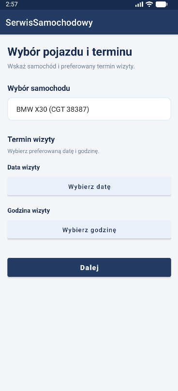
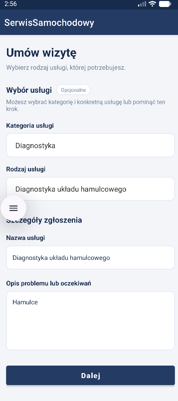
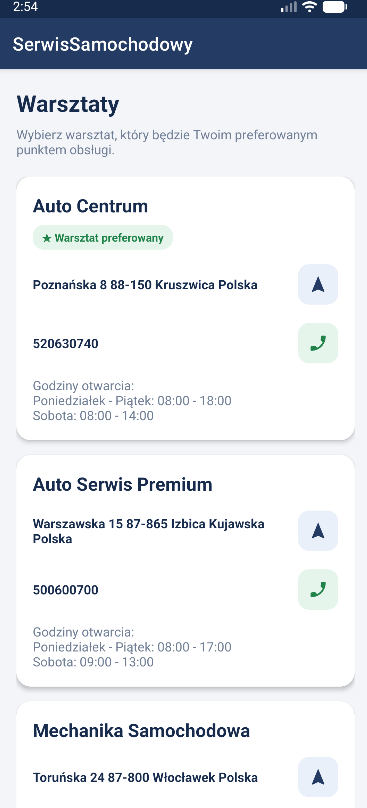
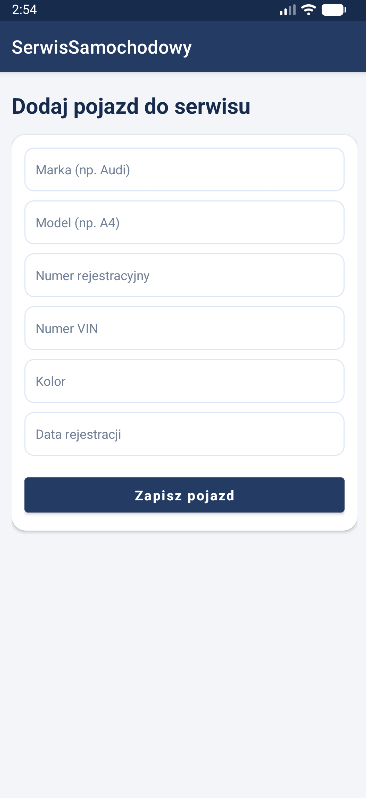
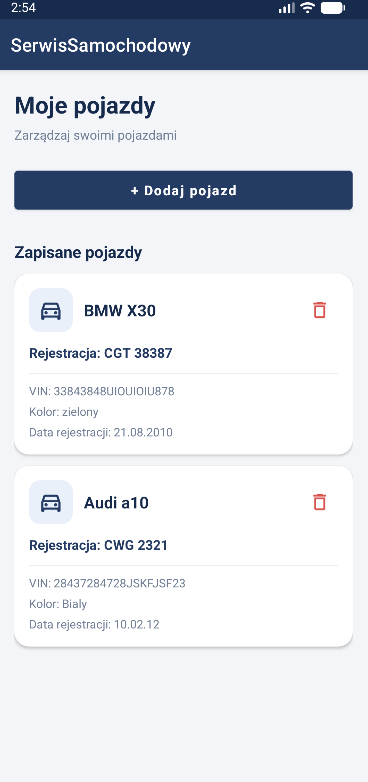
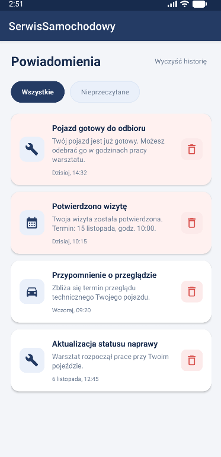
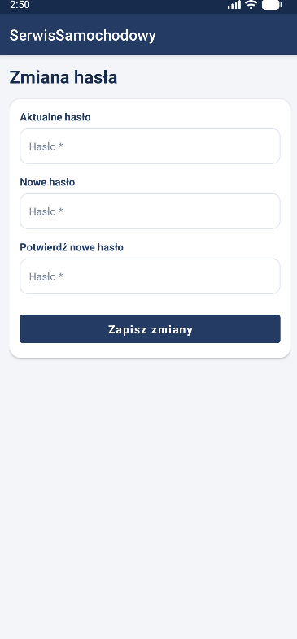
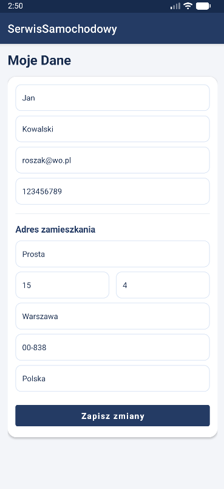
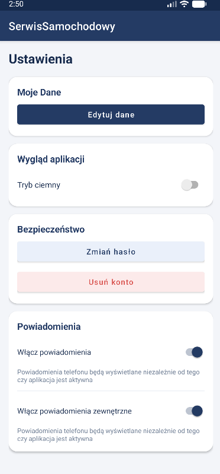
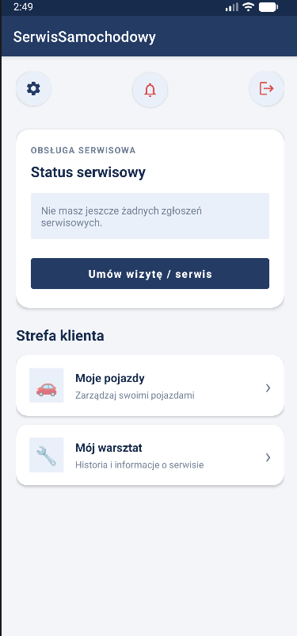

# Serwis Samochodowy

Aplikacja na system Android wspierająca zarządzanie pojazdami oraz rezerwację wizyt serwisowych.

Projekt jest rozwijany w języku Java z wykorzystaniem Android SDK i układów interfejsu XML. Obecnie koncentruje się na interfejsie aplikacji mobilnej, nawigacji pomiędzy ekranami oraz podstawowej funkcjonalności lokalnej.

## Aktualne funkcjonalności

- **Interfejs użytkownika** – ekrany logowania, rejestracji, zarządzania pojazdami, wizytami serwisowymi, warsztatami i ustawieniami użytkownika.
- **Rejestracja i logowanie** – podstawowa funkcjonalność uwierzytelniania użytkowników.
- **Zarządzanie sesją** – podstawowa obsługa sesji użytkownika.
- **Zarządzanie pojazdami** – ekrany i podstawowa funkcjonalność związana z zarządzaniem pojazdami.
- **Warsztaty** – przeglądanie i prezentacja warsztatów.
- **Wizyty serwisowe** – wieloetapowy interfejs rezerwacji wizyt.
- **Zgłoszenia serwisowe** – ekrany i podstawowa lokalna obsługa zgłoszeń.
- **Powiadomienia** – lista powiadomień i podstawowy interfejs ich obsługi.
- **Profil użytkownika** – edycja profilu i zmiana hasła.
- **Ustawienia** – ustawienia aplikacji i opcje konta.
- **Lokalne przechowywanie danych** – baza danych SQLite oraz warstwa dostępu do danych DAO.

*Uwaga: Aplikacja jest nadal w fazie rozwoju. Niektóre funkcjonalności są obecnie dostępne na poziomie interfejsu lub oferują jedynie podstawową obsługę lokalną. Walidacja danych wejściowych, kompleksowa obsługa błędów oraz integracja z backendem nie zostały jeszcze w pełni zaimplementowane.*

## Zrzuty ekranu

| | |
|:---:|:---:|
|  |  |
|  |  |
|  |  |
|  |  |
|  |  |

## Wykorzystane technologie

| Technologia | Zastosowanie |
|---|---|
| Java | Tworzenie aplikacji |
| Android SDK | Platforma aplikacji mobilnej |
| XML | Projektowanie interfejsu użytkownika |
| SQLite | Lokalne przechowywanie danych |
| Gradle | Automatyzacja procesu budowania projektu |
| Android Studio | Środowisko programistyczne |

## Struktura projektu

```text
SerwisSamochodowy/
├── app/
│   └── src/
│       ├── main/
│       │   ├── java/com/example/serwissamochodowy/
│       │   │   ├── app/
│       │   │   ├── dao/
│       │   │   ├── database/
│       │   │   ├── model/
│       │   │   ├── session/
│       │   │   └── ui/
│       │   │       ├── activity/
│       │   │       └── adapter/
│       │   ├── res/
│       │   │   ├── drawable/
│       │   │   ├── layout/
│       │   │   ├── values/
│       │   │   └── xml/
│       │   └── AndroidManifest.xml
│       ├── androidTest/
│       └── test/
├── docs/
│   └── images/
│       ├── 01.png
│       ├── 02.png
│       ├── 03.png
│       ├── 04.png
│       ├── 05.png
│       ├── 06.png
│       ├── 07.png
│       ├── 08.png
│       ├── 09.png
│       └── 10.png
├── gradle/
├── build.gradle.kts
├── settings.gradle.kts
└── gradle.properties
```

## Wymagania

- Android Studio
- Android SDK
- JDK zgodny z konfiguracją Gradle projektu

## Uruchomienie projektu

1. Sklonuj repozytorium:

   ```bash
   git clone https://github.com/markross89/SerwisSamochodowy.git
   ```

2. Otwórz projekt w Android Studio.

3. Poczekaj na zakończenie synchronizacji Gradle.

4. Wybierz emulator Androida lub podłącz fizyczne urządzenie.

5. Zbuduj i uruchom aplikację.

## Planowany rozwój

- Rozbudowa walidacji danych wejściowych i obsługi błędów.
- Udoskonalenie mechanizmu uwierzytelniania i zarządzania sesją.
- Utworzenie osobnego backendu z wykorzystaniem Spring Boot.
- Implementacja komunikacji pomiędzy aplikacją Android a backendem za pomocą REST API.
- Wprowadzenie centralnej bazy danych PostgreSQL.
- Zastąpienie lokalnych operacji na danych komunikacją z backendem.
- Rozbudowa automatycznych testów jednostkowych i integracyjnych.
- Dalsze porządkowanie architektury i organizacji kodu.

## Status projektu

**W trakcie rozwoju.**

Obecna wersja obejmuje warstwę aplikacji mobilnej z podstawową funkcjonalnością lokalną. Utworzenie backendu i integracja z nim są zaplanowane jako osobne etapy projektu.

## Licencja

Projekt jest obecnie udostępniony do celów edukacyjnych i prezentacji w portfolio.

## Autor

**Author:** [markross89](https://github.com/markross89)